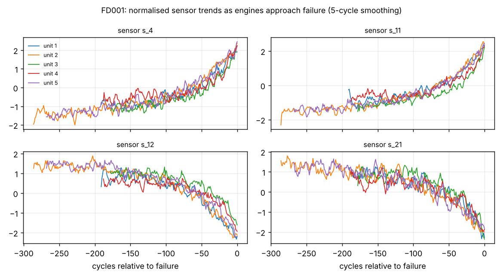
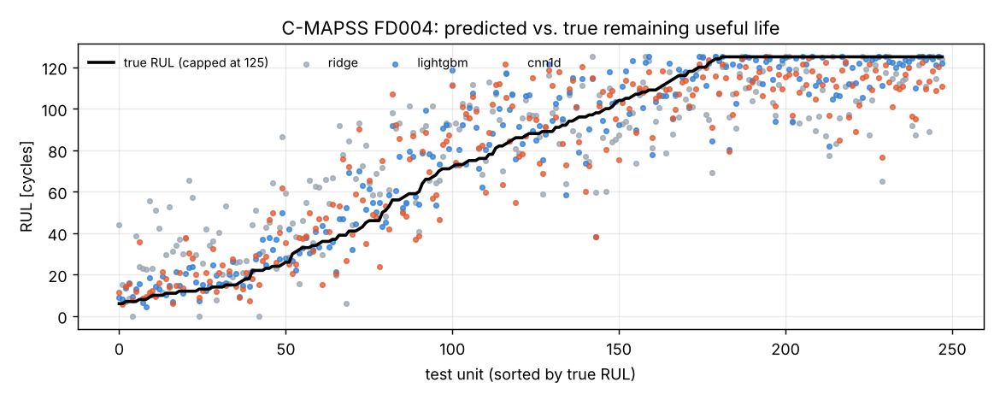

# Predictive Maintenance: Remaining Useful Life (NASA C-MAPSS)

[](https://github.com/Isaac19911369/predictive-maintenance-rul/actions/workflows/ci.yml)


This project predicts **how many operating cycles a turbofan engine has left before failure**. It uses the NASA C-MAPSS run-to-failure simulations and compares a linear baseline, gradient-boosted trees and a 1-D CNN on all four sub-datasets, averaged over three seeds.

The feature pipeline exists in two forms:

- **pandas**, for experiments
- **PySpark**, for fleet-scale data and **Microsoft Fabric** Lakehouses

A test guarantees that both produce identical features. A ready-to-run [Fabric notebook](notebooks/fabric_rul_pipeline.ipynb) takes the model from raw files to Delta tables, MLflow model registration and batch scoring for Power BI.



## Results

The models are evaluated on the official test engines. Each test trajectory is cut off before failure, and the model predicts the remaining life at the last observed cycle. Values are the **mean ± std over seeds 42, 43 and 44**, reproducible with `make benchmark` (about 4 minutes on a 2-core CPU).

| Model | FD001 RMSE | FD001 Score | FD002 RMSE | FD002 Score | FD003 RMSE | FD003 Score | FD004 RMSE | FD004 Score |
|---|---|---|---|---|---|---|---|---|
| Ridge (baseline) | 19.89 ± 0.24 | 767 ± 26 | 18.44 ± 0.02 | 1,610 ± 59 | 18.83 ± 0.05 | 872 ± 19 | 22.43 ± 0.04 | 3,274 ± 80 |
| **LightGBM** | **12.14 ± 0.04** | **228 ± 5** | **13.14 ± 0.22** | **806 ± 22** | **12.52 ± 0.36** | **262 ± 12** | **13.75 ± 0.21** | **861 ± 28** |
| 1-D CNN | 15.24 ± 0.87 | 429 ± 78 | 15.61 ± 0.26 | 1,319 ± 248 | 13.84 ± 0.39 | 369 ± 53 | 17.21 ± 0.16 | 1,378 ± 109 |

*RMSE is in cycles. Score is the asymmetric PHM08 function, in which late predictions cost more than early ones; lower is better. The ground truth uses the same 125-cycle cap as the training target (see Methodology).*



**What the numbers say**

- **Operating-regime normalisation is the biggest single lever.** FD002 and FD004 mix six flight regimes, and each regime shifts every sensor. After z-scoring each sensor per regime, the six-regime subsets come close to the single-regime ones (LightGBM 13.1 vs 12.1 RMSE).
- **Engineered features with GBM beat the CNN here.** The CNN sees only the last 30 raw cycles. LightGBM also sees trend slopes and the engine's age (the cycle counter), which carry much of the RUL signal. The CNN is also more seed-sensitive (±0.9 RMSE on FD001).
- **Errors are mostly at long remaining life.** The plot above shows the model is tightest for engines close to failure, which is the regime that matters for maintenance decisions. Engines with more than 100 cycles left look healthy, so their exact RUL is not identifiable from the sensors.

## Methodology

| Step | Choice | Why |
|---|---|---|
| Target | Piecewise-linear RUL capped at 125 cycles | Early life is flat in the sensors, so an uncapped target forces the model to guess. The cap is the standard practice in C-MAPSS literature |
| Regimes | Rounded settings → 6 discrete regimes (exact in C-MAPSS) | No clustering hyper-parameters, and identical in pandas and Spark |
| Normalisation | Per-regime z-score, fitted on training engines only | Removes regime offsets without leaking test statistics |
| Sensor selection | Drop sensors with zero variance after normalisation | Removes 6 uninformative sensors on FD001 automatically |
| Features | Rolling mean, std and least-squares slope over the last 30 cycles, plus the cycle counter | Computed from rolling sums in O(n), which maps 1:1 onto Spark window functions |
| Validation | 20% of **engines** (not rows) held out for early stopping | Splitting rows would leak an engine's own future into validation |
| Test | Official test set, last cycle per engine | Matches the PHM08 / literature protocol |

## Project layout

```
src/cmapss_rul/
├── data.py             # download, load, RUL labels
├── features.py         # regime normaliser + rolling features (pandas)
├── spark_features.py   # same pipeline in PySpark (Fabric / Databricks / Synapse)
├── models/             # Ridge, LightGBM, 1-D CNN behind one interface
├── metrics.py          # RMSE, PHM08 score, late-prediction rate
├── benchmark.py        # multi-seed benchmark and report
└── cli.py              # cmapss-rul download | benchmark
notebooks/fabric_rul_pipeline.ipynb   # bronze → silver → gold on a Fabric Lakehouse
tests/                  # unit tests, model sanity checks, pandas-vs-Spark parity
```

## Quickstart

```bash
git clone https://github.com/Isaac19911369/predictive-maintenance-rul.git
cd predictive-maintenance-rul
pip install torch --index-url https://download.pytorch.org/whl/cpu
pip install -e ".[dev,spark,plots]"

cmapss-rul download
cmapss-rul benchmark --subsets FD001 FD004 --models lightgbm cnn1d
cmapss-rul benchmark --seeds 42 43 44 --figures docs/figures    # full table above
pytest                                                          # needs Java for the Spark test
```

## Running on Microsoft Fabric

[`notebooks/fabric_rul_pipeline.ipynb`](notebooks/fabric_rul_pipeline.ipynb) is written for a Fabric notebook with an attached Lakehouse. It runs four stages:

1. **Bronze:** raw text files in `Files/cmapss/` → Delta tables `bronze_cmapss_train` and `bronze_cmapss_test`
2. **Silver:** `spark_features` → `silver_cmapss_*_features`, with regime statistics persisted for scoring
3. **Train:** LightGBM with engine-level early stopping, logged to Fabric MLflow and registered as `cmapss-rul-lightgbm`
4. **Gold:** `MLFlowTransformer` batch scoring → `gold_cmapss_rul_predictions`, with a maintenance bucket (*urgent / plan / healthy*) for a Direct Lake Power BI report

The notebook isn't executed in CI because it needs a Fabric runtime. Its feature code is the tested `spark_features` module.

## Limitations and next steps

- **Point estimates only.** Maintenance planning needs uncertainty. Quantile LightGBM or conformal prediction intervals are the natural next step.
- **Simulated data.** C-MAPSS is clean simulation data. Real fleets add missing data, sensor replacements and maintenance resets, which need event-aware feature logic.
- **Model scope.** Longer windows, attention models, and adding the cycle counter as a channel to the CNN would make the deep-learning comparison fairer.
- **Decision layer.** Optimising the urgent/plan thresholds against maintenance cost, rather than fixed cut-offs.

## Data and licence

The C-MAPSS data comes from the NASA Prognostics Data Repository (public domain): A. Saxena, K. Goebel, D. Simon, N. Eklund, *Damage Propagation Modeling for Aircraft Engine Run-to-Failure Simulation*, PHM 2008. It is downloaded at runtime and is not included in this repository.

The code is released under the [MIT License](LICENSE).

---

Built by [Dr. Eshagh Dehmollaian](https://github.com/Isaac19911369). This is a companion to [iot-anomaly-detection](https://github.com/Isaac19911369/iot-anomaly-detection): anomaly detection tells you *that* something is wrong, and RUL tells you *how long you have*.
